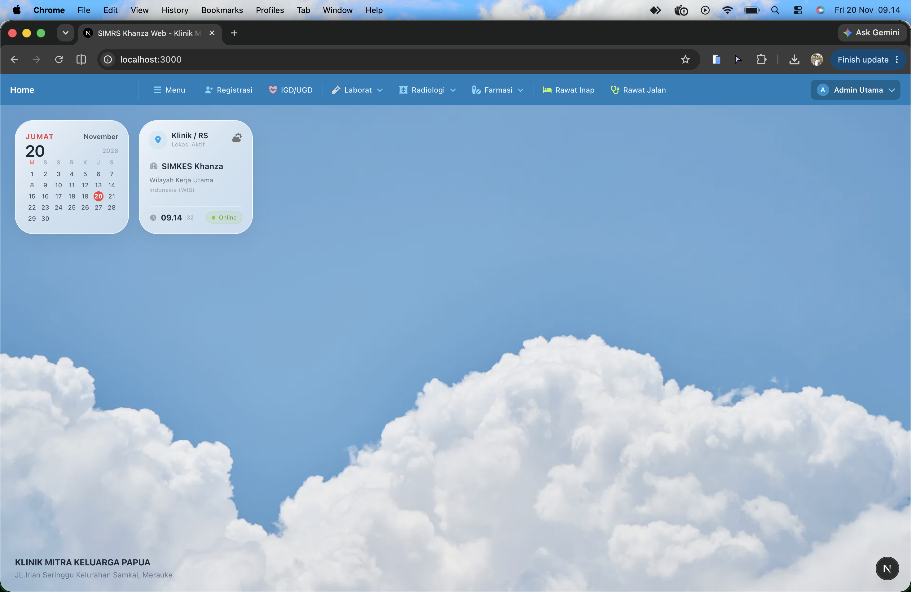
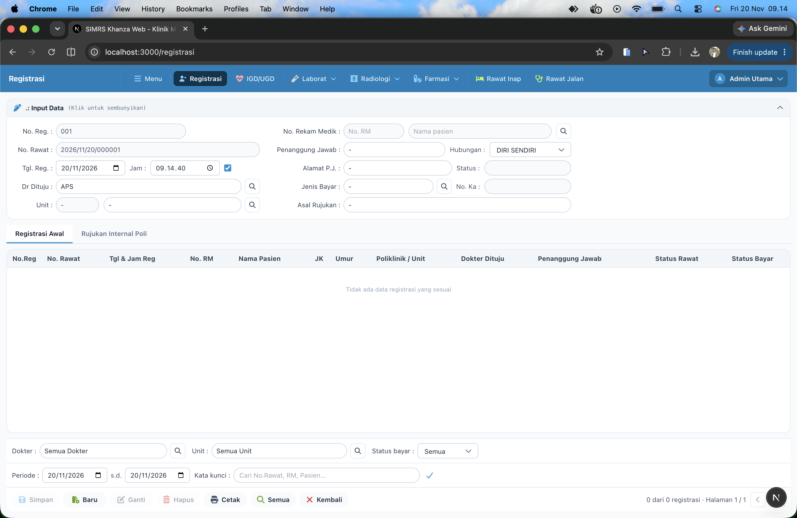
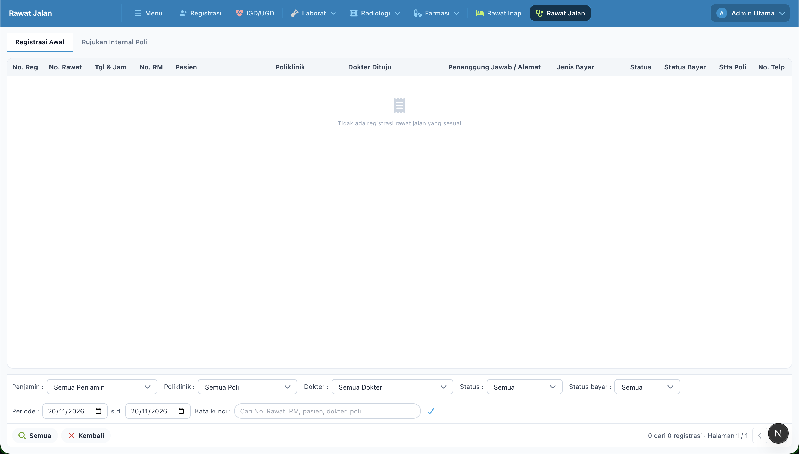

# SIMRS Khanza Web

SIMRS Khanza Web adalah aplikasi berbasis web untuk memodernisasi penggunaan SIMRS Khanza secara bertahap. Aplikasi dibangun dengan Next.js, React, TypeScript, dan Tailwind CSS serta tetap mempertahankan kompatibilitas aturan bisnis Khanza.

Fitur utama yang tersedia saat ini:

- Login akun admin dan pegawai Khanza.
- Menu utama dan navigasi modul rumah sakit.
- Pengelolaan data pasien.
- Registrasi pasien dan rujukan internal poli.
- Halaman awal IGD, rawat jalan, rawat inap, laboratorium, radiologi, dan farmasi.
- Penguncian sesi serta sinkronisasi login/logout antar-tab.

## Tampilan aplikasi

### Halaman utama

Halaman utama menyediakan akses cepat ke modul-modul layanan dan ringkasan konteks aplikasi.



### Registrasi pasien

Halaman registrasi mendukung input kunjungan, rujukan internal, pencarian, filter, dan daftar registrasi.



### Rawat jalan

Halaman rawat jalan menampilkan daftar kunjungan serta filter penjamin, poliklinik, dokter, status, periode, dan kata kunci.



## Instalasi

Kebutuhan:

- Node.js yang kompatibel dengan Next.js 16.
- MariaDB 10.x atau MySQL 8.x.
- Database SIMRS Khanza.

Pasang dependency:

```sh
npm install
```

Salin konfigurasi environment:

```sh
cp .env.example .env.local
```

Isi koneksi database dan konfigurasi keamanan pada `.env.local`:

```env
DB_HOST=
DB_PORT=3306
DB_USER=
DB_PASSWORD=
DB_NAME=

KHANZA_AES_USER_KEY=
KHANZA_AES_PASS_KEY=
SESSION_SECRET=

KHANZA_URUTNOREG=dokter + poli
KHANZA_BASENOREG=booking
```

Jalankan aplikasi:

```sh
npm run dev
```

Buka `http://localhost:3000` pada browser.

Untuk build produksi:

```sh
npm run build
npm run start
```

## Dokumentasi

- [Riwayat dan panduan pengembangan](docs/README.md)
- [Struktur aplikasi dan schema database](docs/schema.md)
- [Aturan wajib proyek](AGENTS.md)

Jangan commit `.env*`, dump database, atau data pasien ke repository.
